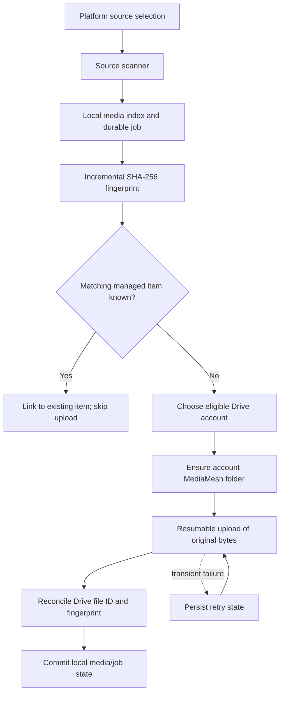

# Architecture

## Architectural decisions

- The product is one Flutter client targeting Android, Web, Windows, and Linux. Shared product rules live in the application core; filesystem, OAuth callback, secure storage, local persistence, background scheduling, and media decoding are platform adapters.
- There is no MediaMesh backend, server-side database, upload proxy, or shared client state.
- Each client connects directly to Google Drive and maintains its own local database. Google Drive is the shared remote store for managed media; local indexes may be stale or differ between devices until refreshed.
- MediaMesh manages only the visible `MediaMesh` folder in each connected Drive account. It is not a general Drive browser or sync engine.
- MVP synchronization is one-way backup. Download/restore is explicit. No operation propagates deletion to the source or automatically deletes a remote duplicate.

## Logical components

| Component | Responsibility | Must not do |
|---|---|---|
| Presentation | Account setup, source setup, library/search, transfer progress, error/recovery actions, English/Polish localization, semantic appearance tokens | Store OAuth tokens or implement Drive API policy in widgets; hard-code translated strings or palette colors |
| Application core | Use cases for connect, scan, fingerprint, deduplicate, choose account, enqueue/transfer, reconcile, browse, and restore | Depend on a specific OS file API or a MediaMesh server |
| Theme configuration | Resolve the saved appearance mode, current system color-scheme preference, and selected palette into shared light/dark semantic design tokens | Persist settings remotely, alter media, or encode palette colors directly into feature widgets |
| Local repository | Persist account metadata, sources, media index, thumbnails, upload jobs, and history; page/index queries; migrate schema | Store raw OAuth tokens in ordinary database columns |
| Drive adapter | OAuth-aware Drive API operations, managed-folder discovery, listing, quota reads, resumable transfer, and remote reconciliation | Access or modify unrelated Drive files |
| Source adapter | Enumerate/read user-selected files and detect changes using platform APIs | Move, edit, or delete source media |
| Credential vault | Store/retrieve/remove credentials through platform-secure mechanisms | Log or expose token values to UI, diagnostics, or database |
| Preview adapter | Decode supported image/video previews and cache generated thumbnails | Change bytes of the original media |
| Platform services | File pickers/watchers, connectivity, background scheduling, local secure storage, and destination selection | Promise unsupported background or codec behavior |

Implement adapters behind application-owned interfaces. Equivalent behavior can use different platform APIs; do not make platform-specific details leak into functional rules.

## Appearance configuration

The shared presentation layer resolves appearance according to FR-016. It reads the client-local `theme_mode` and `color_palette` settings, uses the current platform color-scheme preference only when mode is `system`, and selects the corresponding light or dark variant of the chosen palette. Mode or palette changes take effect immediately and remain local to the installation.

Application-owned components consume semantic design tokens for surfaces, text, controls, focus, selection, and status. Success, warning, and error semantics remain consistent across palettes, and status/focus/selection remain perceivable without color alone. Media previews and originals are not recolored or modified; the theme configuration must not transform or rewrite media content.

## Data flow: backup

### Backup sequence and state

1. The source adapter obtains a user-selected file reference and permission. It reads metadata in bounded batches.
2. The application core writes or updates a local media record and durable job before network transfer begins.
3. The fingerprint service streams bytes to calculate SHA-256; it must not load a complete large file into memory.
4. The deduplication service checks the local index and managed-folder indexes for a matching fingerprint. A known match is linked and not uploaded again.
5. The account-selection service selects the eligible account with the most recently refreshed known free bytes, unless the user chose an account manually. A manual choice with unknown/stale quota requires an explicit warning; unknown or insufficient quota is never represented as guaranteed success.
6. The Drive adapter creates or reuses the visible `MediaMesh` folder and performs a resumable upload of original bytes. Set `appProperties.mediaMeshManaged=true` and `appProperties.mediaMeshSchemaVersion=1` on app-managed folders/files; set `appProperties.mediaMeshSha256` to the canonical digest on files where supported.
7. The Drive result (account ID, folder ID, file ID, size, fingerprint, and timestamps) is reconciled and committed locally. A request with an ambiguous outcome is looked up/reconciled before another create request is sent.

Recommended durable job states are `discovered`, `fingerprinting`, `duplicate`, `queued`, `uploading`, `retry_wait`, `completed`, `source_missing`, `needs_authorization`, `quota_blocked`, and `failed_permanent`. State transitions must be validated and persisted transactionally. A retry must preserve the source identity and re-check its fingerprint.

### Cross-client duplicate limitation

Independent clients do not share an atomic lock or database. They can both observe no matching remote fingerprint and upload the same item concurrently. Clients must reconcile and report matches when they refresh the managed folder, but must never delete one copy automatically. Strict global exactly-once upload is not promised without a coordinating service.

## Data flow: remote index, gallery, and restore

- On account connection/startup/manual refresh, the Drive adapter pages only the managed folder and upserts records into the local index. Use stable Drive IDs and provider pagination tokens; do not fetch full media bytes to populate the gallery.
- Gallery, search, filters, and sort order are served from indexed local data with a maximum result page size of 100. Cached/stale status is preserved while offline.
- Thumbnail generation is on-demand and cached locally. An unavailable decoder produces a placeholder; it does not mark the remote original missing.
- Restore starts only after explicit user action. The destination adapter avoids overwriting an existing file by default. Where a SHA-256 value is known, verify the downloaded bytes before reporting completion.
- When a managed file disappears remotely, mark the local remote record as missing/out-of-sync. Do not delete the source file or claim that a Drive delete can be undone.

## OAuth and Google Drive boundary

- Use Google-supported OAuth 2.0 flows appropriate to installed Android, desktop, and browser clients. Use platform-specific registered client IDs under the configured Google Cloud project; never ship a client secret.
- Keep credentials in the platform credential vault. The UI and application database receive account identity/state, not token material.
- Request the least-privilege scope that supports the managed folder. Validate that one platform client can list/read files created by the other platform clients before release. If the chosen scope cannot provide this behavior, report the limitation and request a deliberate authorization decision; do not silently broaden access.
- A folder with the name `MediaMesh` is not automatically trusted. Verify the app marker or ask the user to explicitly adopt it before indexing/writing. Do not treat unrelated files in Drive as managed.
- A remote copy with no valid app fingerprint is not an exact-content match. Do not skip an upload based only on name, date, MIME type, or size; calculate and verify a content hash before treating it as a duplicate.
- The Drive adapter exposes typed outcomes for authorization, permission, quota, network/API, not-found, and resumable-session errors. It applies bounded retry only to transient errors.
- Store provider IDs, MIME type, size, timestamps, and app-managed fingerprint metadata as available. Never treat a missing provider field as proof that file content is a duplicate or that the file is safe to delete.

## Platform adapters and persistence

| Platform | Source access | Local persistence / credential constraint | Background and preview constraint |
|---|---|---|---|
| Android | User-selected device media/folders with explicit runtime permission | Encrypted local database and Android secure credential storage | Use OS-scheduled work; execution timing is not guaranteed. Preview/playback depends on installed/platform decoders. |
| Web | Explicit browser file/folder selection | Browser-origin-bound persistence and Web Crypto where available; no bearer/refresh token in ordinary local storage | No persistent folder monitor or upload after browser shutdown. Browser codec and storage-quota limits must be surfaced. |
| Windows | User-selected folders | Encrypted local database and Windows secure credential storage | Monitor selected folders while running; rescan after restart. |
| Linux | User-selected folders | Encrypted local database and OS secret service; if unavailable, fail closed or require an explicit secure recovery path | Monitor selected folders while running; rescan after restart. |

Use a common repository contract with platform-specific persistence implementations (SQLite on native platforms and browser storage appropriate to Web). The actual database/crypto packages are implementation choices; preserve one logical schema and migration behavior across platforms. Web encryption at rest does not protect against same-origin script compromise.

## Failure and consistency rules

- Persist transfer intent before sending requests. Report progress from provider-confirmed bytes/state rather than optimistic success.
- Transient network/API failures retain a retryable job with bounded backoff. Authorization, permissions, source access, and quota failures remain blocked until the user can act.
- A source disappearing before upload moves the job to `source_missing`. It does not cancel unrelated jobs or delete an earlier Drive copy.
- An OAuth revocation invalidates the affected account's pending requests and requires reauthorization. Other accounts remain usable.
- Local cache records are eventually consistent with Drive. Show stale state after offline operation or failed refresh; never present a cached result as a completed remote operation.
- Local DB migration/storage errors must stop unsafe writes and provide recovery/export guidance. Never silently reset a library or queue.

## Explicitly excluded architecture

No hosted MediaMesh account/service, server-side metadata store, queue service, file proxy, peer-to-peer client sync, two-way conflict engine, cloud cleanup task, AI processing service, or non-Google provider adapter is part of MVP. See `07_FUTURE_ROADMAP.md` for deferred product directions.
