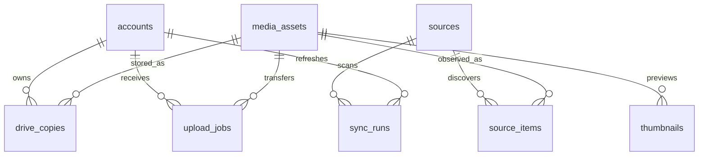

# Local Database Schema

## Database purpose and portability

The database is client-local. It stores account identity and quota metadata, selected sources, a searchable library index, thumbnails/cache references, durable work, and sync history. It is not a shared service and does not contain OAuth bearer or refresh tokens.

Use the same logical schema and migration semantics on all platforms. Native platforms may use encrypted SQLite; Web uses browser-origin-bound persistence with equivalent entity and query behavior. Every persisted timestamp is UTC. Byte sizes use non-negative integer byte counts. Store SHA-256 values as exactly 64 lowercase hexadecimal characters and validate that format at the persistence boundary.

Encrypt sensitive local metadata at rest according to `03_NON_FUNCTIONAL_REQUIREMENTS.md`. Paths, folder locators, and resumable-upload session URLs are sensitive. Credentials belong only in the platform secure credential store.

## Entities

### `accounts`

One row per connected Google account on this installation.

| Column | Type / constraints | Purpose |
|---|---|---|
| `account_id` | UUID/text primary key | Stable local account reference. |
| `provider` | Text, required, currently `google` | Provider discriminator for future extensibility. |
| `email` | Text, required | User-visible account identity; normalize for comparison. |
| `normalized_email` | Text, required | Case/format-normalized identity used for uniqueness checks. |
| `drive_folder_id` | Text, nullable until provisioned | Google Drive ID of the managed `MediaMesh` folder. |
| `connection_state` | Enum: `connected`, `reauthorization_required`, `disconnected`, `error` | Non-secret authorization state. |
| `quota_total_bytes` | Integer, nullable | Last known total quota. |
| `quota_used_bytes` | Integer, nullable | Last known used quota. |
| `quota_checked_at` | UTC timestamp, nullable | Staleness indicator for quota values. |
| `created_at`, `updated_at` | UTC timestamps | Local record lifecycle. |

Constraints/indexes: unique `(provider, normalized_email)`; index `connection_state`. Store a secure-vault key/reference if necessary, never token material. Disconnect clears credentials and prevents new jobs for that account; it retains remote-copy metadata unless the user clears local data.

### `sources`

One row per user-selected source root or Web import session.

| Column | Type / constraints | Purpose |
|---|---|---|
| `source_id` | UUID/text primary key | Stable source reference. |
| `platform` | Enum: `android`, `web`, `windows`, `linux` | Source adapter that owns the locator. |
| `source_type` | Enum: `device_media`, `folder`, `web_selection` | Intake behavior. |
| `locator` | Text, encrypted at rest, nullable | Platform-specific folder/media reference; do not assume paths are portable. |
| `locator_key` | 32-byte HMAC-SHA-256, nullable | Stable non-reversible key for matching the same selected source without indexing a plaintext path; key is installation-specific and protected by the platform credential store. |
| `permission_state` | Enum: `available`, `denied`, `revoked`, `unavailable`, `session_only` | Ability to rescan/read this source. |
| `monitor_enabled` | Boolean | User-selected monitoring state; Web is explicit selection only. |
| `last_scan_at` | UTC timestamp, nullable | Most recent completed discovery pass. |
| `scan_cursor` | Text/blob, nullable | Adapter-owned continuation state; clear when invalid. |
| `created_at`, `updated_at` | UTC timestamps | Source lifecycle. |

Index `monitor_enabled`, `permission_state`. A source row does not grant permission by itself; the platform adapter must revalidate access before reading.

### `media_assets`

One logical media item/content record. Known exact-content fingerprints map to one local asset; several source observations or remote copies may reference that asset.

| Column | Type / constraints | Purpose |
|---|---|---|
| `asset_id` | UUID/text primary key | Stable local identity independent of filenames and provider IDs. |
| `sha256` | Exactly 64 lowercase hexadecimal characters, nullable | Exact-content identity when calculated/known. |
| `media_type` | Enum: `photo`, `video`, `unknown` | Gallery grouping. |
| `file_name` | Text, nullable | Display name; may vary between source aliases/copies. |
| `mime_type` | Text, nullable | Provider/source MIME hint; not trusted as proof of content. |
| `size_bytes` | Integer, nullable | Original content size. |
| `capture_time_utc` | UTC timestamp, nullable | Capture time only when reliable metadata exists. |
| `capture_time_source` | Enum/text, nullable | `embedded_metadata`, `provider_metadata`, or `unknown`; distinguish capture time from fallback display dates. |
| `fingerprint_state` | Enum: `unknown`, `pending`, `known`, `failed` | Whether exact-content identity can be used for deduplication. |
| `created_at`, `updated_at` | UTC timestamps | Local record lifecycle. |

Constraints/indexes: unique `sha256` when non-null; index `(media_type, capture_time_utc, asset_id)` for deterministic gallery paging; index `file_name` for local search. If source bytes change, create/update the corresponding source observation to reference a new fingerprinted asset; do not replace/delete the prior remote copy automatically.

### `source_items`

One observation of a media file at a selected source location.

| Column | Type / constraints | Purpose |
|---|---|---|
| `source_item_id` | UUID/text primary key | Stable local item reference. |
| `source_id` | FK to `sources`, required | Source root/session. |
| `asset_id` | FK to `media_assets`, required | Current content identity for this observation. |
| `locator` | Text, encrypted at rest | Platform-specific file URI/identifier; never expose in diagnostics without redaction. |
| `locator_key` | 32-byte HMAC-SHA-256 | Stable source-relative identity used for change detection; key is installation-specific and protected by the platform credential store. |
| `file_name` | Text, required | Source name. |
| `size_bytes` | Integer, nullable | Last observed source size. |
| `modified_at` | UTC timestamp, nullable | Source change detection hint, not an exact-content identity. |
| `availability_state` | Enum: `available`, `missing`, `permission_denied`, `changed` | Readability of the current source item. |
| `last_seen_at` | UTC timestamp | Last successful scan observation. |

Constraints/indexes: unique `(source_id, locator_key)`; index `asset_id`; index `(source_id, availability_state)`. A missing source item remains linked to its asset and remote copies.

### `drive_copies`

One managed Drive file observed or created by this installation. A single asset may have multiple copies, including copies found after independent clients uploaded concurrently.

| Column | Type / constraints | Purpose |
|---|---|---|
| `drive_copy_id` | UUID/text primary key | Stable local copy reference. |
| `asset_id` | FK to `media_assets`, required | Local logical media record. |
| `account_id` | FK to `accounts`, required | Owning connected account. |
| `drive_file_id` | Text, required | Stable provider file ID. |
| `parent_folder_id` | Text, required | Must equal the account's managed folder ID. |
| `remote_name` | Text, required | Provider-visible file name. |
| `mime_type`, `size_bytes` | Text / integer, nullable | Provider metadata. |
| `remote_state` | Enum: `present`, `missing`, `inaccessible`, `unknown` | Last reconciled remote state. |
| `remote_created_at`, `remote_modified_at` | UTC timestamps, nullable | Provider timestamps. |
| `last_seen_at` | UTC timestamp | Last successful reconciliation. |

Constraints/indexes: unique `(account_id, drive_file_id)`; index `(asset_id, remote_state)`; index `(account_id, parent_folder_id, remote_state)`. Rows may be marked missing/inaccessible but are not automatically deleted.

### `upload_jobs`

Durable one-way transfer work. Persist a job before making a create/upload request.

| Column | Type / constraints | Purpose |
|---|---|---|
| `job_id` | UUID/text primary key | Stable idempotency/reconciliation reference. |
| `source_item_id` | FK to `source_items`, required | Source to read without modifying. |
| `asset_id` | FK to `media_assets`, required | Content expected by the job. |
| `destination_account_id` | FK to `accounts`, required | Selected eligible destination; update only through an explicit retry/reselection action. |
| `state` | Required enum from the architecture state machine | Durable workflow state. |
| `attempt_count` | Non-negative integer | Retry diagnostics. |
| `next_attempt_at` | UTC timestamp, nullable | Bounded backoff scheduling. |
| `upload_session_ref` | Text/blob, encrypted at rest, nullable | Provider resumable session reference; clear when completed/invalid. |
| `provider_file_id` | Text, nullable | Reconcile an ambiguous or completed create request. |
| `last_error_category`, `last_error_at` | Text/timestamp, nullable | User-safe error classification and history. |
| `created_at`, `updated_at` | UTC timestamps | Job lifecycle. |

Indexes: `(state, next_attempt_at)`, `(destination_account_id, state)`, and `asset_id`. In one transaction, prevent more than one active job for the same `asset_id` and destination account. Retrying after a possibly successful create must reconcile `provider_file_id`/fingerprint first.

### `download_jobs`

Durable work created only after an explicit restore/download action.

| Column | Type / constraints | Purpose |
|---|---|---|
| `download_job_id` | UUID/text primary key | Stable download operation. |
| `drive_copy_id` | FK to `drive_copies`, required | Remote source copy. |
| `destination_locator` | Text, encrypted at rest, nullable until chosen | Platform-specific destination. |
| `state` | Enum: `queued`, `downloading`, `retry_wait`, `completed`, `needs_user_action`, `failed_permanent` | Durable workflow state. |
| `attempt_count` | Non-negative integer | Retry diagnostics. |
| `temporary_locator` | Text, encrypted at rest, nullable | Partial file location; must not replace a final file before verification. |
| `last_error_category`, `last_error_at` | Text/timestamp, nullable | Redacted error category and time. |
| `created_at`, `updated_at` | UTC timestamps | Job lifecycle. |

Indexes: `(state, created_at)` and `drive_copy_id`. Download jobs must verify a known fingerprint before atomic placement at the destination and resolve filename collisions non-destructively.

### `thumbnails`

Local-only, regenerable preview cache.

| Column | Type / constraints | Purpose |
|---|---|---|
| `thumbnail_id` | UUID/text primary key | Cache record. |
| `asset_id` | FK to `media_assets`, required | Previewed content. |
| `variant` | Text, required | Size/format variant identifier. |
| `cache_locator` | Text, required | Platform-specific cache reference. |
| `generation_state` | Enum: `ready`, `pending`, `unsupported`, `failed` | Preview outcome. |
| `generated_at`, `last_accessed_at` | UTC timestamps, nullable | Cache lifecycle/eviction input. |

Constraints/indexes: unique `(asset_id, variant)`; index `last_accessed_at`. Eviction removes cache content and its row only; it never removes media assets, source items, or Drive copies.

### `sync_runs`

Local history for source scans, remote refreshes, and queued transfer batches.

| Column | Type / constraints | Purpose |
|---|---|---|
| `run_id` | UUID/text primary key | Run identity. |
| `run_type` | Enum: `source_scan`, `drive_refresh`, `upload_batch`, `download` | Operation category. |
| `source_id` | Nullable FK to `sources` | Source involved, when applicable. |
| `account_id` | Nullable FK to `accounts` | Account involved, when applicable. |
| `state` | Enum: `running`, `completed`, `partial`, `failed`, `cancelled` | User-visible outcome. |
| `started_at`, `finished_at` | UTC timestamps | Run duration and recovery. |
| `items_seen`, `items_succeeded`, `items_failed` | Non-negative integers | Summary counters. |
| `error_category` | Text, nullable | Redacted summary; no token or raw sensitive path. |

Index `(started_at, run_type)` and `(account_id, started_at)`.

### `schema_migrations` and `settings`

- `schema_migrations(version, applied_at)` records ordered local schema upgrades.
- `settings(key, value, updated_at)` stores non-secret, client-local preferences such as sort order, thumbnail-cache configuration, and appearance settings. Never store OAuth tokens, encryption keys, or credentials in settings.

Appearance settings defined by FR-016:

| Key | Allowed values | Default | Behavior |
|---|---|---|---|
| `theme_mode` | `system`, `light`, `dark` | `system` | `system` follows the current operating system or browser color-scheme preference; `light` and `dark` explicitly override it. |
| `color_palette` | `ocean`, `forest`, `violet`, `sunset` | `ocean` | Selects a palette with both light and dark variants. |

These settings are stored only in the current installation and MUST NOT be synchronized through Google Drive. Missing or invalid values resolve to the defaults without blocking startup or changing unrelated preferences. Migrations preserve existing settings and MUST NOT modify user media.

## Relationships

## Migration and data-safety rules

- Apply migrations transactionally where the platform store permits. Record the version only after success.
- Migrations preserve source observations, known Drive IDs, pending upload jobs, fingerprints, and cache references that remain valid.
- When a fingerprint becomes known for a previously unindexed source or remote copy, reconcile it with an existing equal SHA-256 asset before linking. If equal, repoint source/copy/job references to the canonical asset transactionally; retain every `drive_copies` row and never delete a cloud file as part of this merge.
- If an installation-specific locator HMAC key is lost or rotated, mark source matching keys for regeneration during a permission-checked rescan; do not infer that a source was deleted.
- On migration failure, stop writes and provide recovery/export instructions; do not silently drop or recreate user data.
- Clearing thumbnails is always safe. Clearing a database or account metadata is a separate explicit action and must warn that cached indexes/jobs are removed while cloud files and source originals are not.
- State enums and unique/index constraints must be implemented consistently across native and Web persistence adapters.
